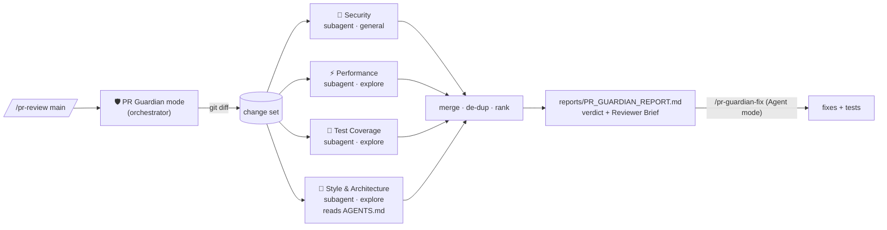

# 🛡️ PR Guardian

**Four parallel IBM Bob specialists review every pull request — one severity-ranked report, before a tired human ever opens the diff.**

> Built for the IBM Bob 2.0 Hackathon (lablab.ai, 25–27 Sep 2026). IBM Bob IDE is the core of the solution:
> PR Guardian is a portable `.bob/` configuration — a custom mode, a skill, four specialist checklists and two slash commands.

## The problem
Pull requests wait days for review. When the review finally happens, one exhausted reviewer must be a security
engineer, a performance engineer, a test engineer and the keeper of the team's conventions — all at once, at 6 pm.
Things slip through.

## The solution
Open the branch in Bob IDE and type `/pr-review main`. The 🛡️ PR Guardian mode:

1. captures the change set (`git diff`),
2. spawns **four specialist subagents in parallel**, each with an isolated context and its own checklist —
   **Security** · **Performance** · **Test Coverage** · **Style & Architecture** (the last one reads the repo's `AGENTS.md` conventions),
3. merges their findings into `reports/PR_GUARDIAN_REPORT.md` with a verdict
   (🔴 BLOCK / 🟡 NEEDS CHANGES / 🟢 APPROVE WITH COMMENTS), **Critical / Warning / Suggestion** levels and a
   **Reviewer Brief** — the three places the human should look first.

The mode is **read-only on source code** (its `edit` permission is restricted to `reports/`). Fixing is a separate,
explicit step: `/pr-guardian-fix` in Agent mode applies the Critical fixes and writes the missing tests.



## Why not just Bob's built-in `/review`?
`/review` is one generalist pass. PR Guardian is a **team of specialists**: each subagent gets a fresh context, a
focused checklist and only its own job, so the security reviewer never runs out of attention because it was also
counting tests. The result is merged, de-duplicated and ranked, and the orchestrator is sandboxed to `reports/`.

## Repository layout
| Path | Purpose |
|---|---|
| [`.bob/custom_modes.yaml`](.bob/custom_modes.yaml) | The PR Guardian mode (tool groups, `edit` restricted to `reports/`, allowed subagents) |
| [`.bob/skills/pr-guardian-review/`](.bob/skills/pr-guardian-review/) | Review protocol skill, finding schema, report template, 4 specialist checklists |
| [`.bob/rules-pr-guardian/`](.bob/rules-pr-guardian/) | Mode rules: condensed workflow + severity definitions |
| [`.bob/commands/`](.bob/commands/) | `/pr-review <base-branch>`, `/pr-guardian-fix` |
| [`demo-app/`](demo-app/) | **TaskFlow** — Flask + SQLite API used as the review target; conventions in [`demo-app/AGENTS.md`](demo-app/AGENTS.md) |
| [`reports/`](reports/) | Generated reports |
| [`bob_sessions/`](bob_sessions/) | Bob IDE task-session summaries + exports (hackathon evidence) |
| [`docs/`](docs/) | Statements, demo runbook, slides, video script |
| [`scripts/score_report.py`](scripts/score_report.py) | Scores a report against the seeded benchmark |

## Try it (5 minutes)
```bash
git clone <this repo> && cd pr-guardian
git checkout feature/search-export-report      # the PR under review (12 seeded defects)
```
1. Open the folder in **IBM Bob IDE**. The 🛡️ PR Guardian mode appears in the mode picker automatically.
2. In chat: `/pr-review main` → approve the subagent spawns → watch the parallel-subagents panel.
3. Read `reports/PR_GUARDIAN_REPORT.md`, then `python scripts/score_report.py reports/PR_GUARDIAN_REPORT.md`.
4. Switch to Agent mode → `/pr-guardian-fix` → `cd demo-app && python -m pytest -q`.

## Benchmark
`feature/search-export-report` plants 12 defects (4 security, 4 performance, 1 test gap, 3 style/architecture).
The answer key lives in `docs/answer-key/` and is excluded from Bob's view via `.bobignore`.

| Run | Caught | Critical found | Wall-clock | Report |
|---|---|---|---|---|
| _(filled in after the recorded run)_ | – / 12 | – / 4 | – | `reports/PR_GUARDIAN_REPORT.md` |

## Use it on your own repo
Copy the `.bob/` folder into your project root, add (or `/init`) an `AGENTS.md` describing your conventions,
open it in Bob IDE and run `/pr-review <base-branch>`. Nothing else to install.

## Roadmap
- Bob Shell headless run inside a GitHub Action (post the report as a PR comment)
- Bob **workflow** version: deterministic diff/score steps + parallel AI steps
- Per-repo severity policy (`.bob/rules-pr-guardian/10-severity.md` is already the knob)

## Data & licence
All code and data are self-created and synthetic. No customer or personal data. MIT licence.
